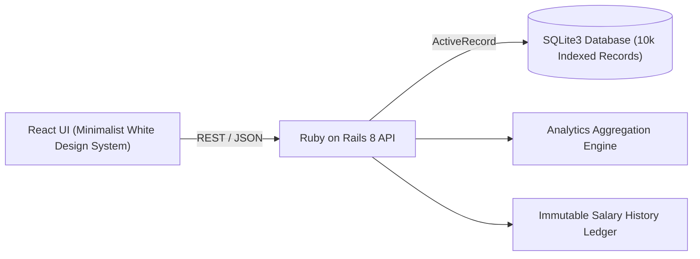

# ACME Global Salary Management Platform

A high-performance, minimalist enterprise web application built for an organization of **10,000 employees across 7 global regions and currencies**. Engineered with a **Ruby on Rails 8 API backend**, **SQLite relational database** (with compound indexing, foreign keys, and WAL mode), and a **clean, minimalist React frontend**.

---

## 1. Executive Summary & Problem Framing

ACME Corporation's People Operations team previously managed compensation data across multiple international offices using fragmented spreadsheets. This created critical operational challenges:
- High operational overhead and manual error rates across multi-currency operations.
- Lack of an immutable audit trail for salary updates, promotions, and market adjustments.
- Inability for HR leadership to promptly and accurately answer how the organization pays its people (e.g. departmental cost drivers, country parity benchmarks, bonus distributions).

### The Solution
A centralized web application with:
1. **Sub-second Directory Browsing:** Server-side paginated and indexed browsing of 10,000 employees with multi-dimensional filtering (Department, Country, Currency, Status) and instant debounced search.
2. **Multi-Currency Normalization:** Preservation of nominal local contractual salaries (`USD`, `EUR`, `GBP`, `INR`, `CAD`, `SGD`, `AUD`) alongside standardized USD conversions benchmarked to corporate planning exchange rates.
3. **Atomic Salary Adjustment & Immutable Audit Ledger:** Revisions to compensation are wrapped in database transactions that update the employee record and log a cryptographically immutable `SalaryHistory` audit event.
4. **Compensation Intelligence Dashboard:** Answers key organizational questions with aggregated metrics (payroll totals, headcount, median benchmark, departmental spend, and regional cost drivers).

---

## 2. Architecture & Tech Stack



- **Backend:** Ruby on Rails 8.1 API mode
- **Database:** SQLite 3 with WAL (Write-Ahead Logging) and composite indexes on `(department, country, status)` and `(last_name, first_name)`
- **Frontend:** React 18 with Vite, minimalist design system, clean typography (Inter font), and subtle semantic badges
- **Monetary Safety:** All compensation figures stored using `DECIMAL(14,2)` precision (never floating point)

---

## 3. Project Structure

```
Incubyte/
├── backend/                  # Ruby on Rails 8 API
│   ├── app/
│   │   ├── controllers/api/v1/
│   │   │   ├── employees_controller.rb
│   │   │   └── analytics_controller.rb
│   │   ├── models/
│   │   │   ├── employee.rb
│   │   │   ├── salary_history.rb
│   │   │   └── exchange_rate.rb
│   │   └── services/
│   │       └── analytics_service.rb
│   ├── db/
│   │   ├── migrate/
│   │   └── seeds.rb          # Deterministic 10,000-employee seed
│   └── test/                 # Automated Minitest suite (19 tests, 97 assertions)
├── frontend/                 # React 18 Application
│   ├── src/
│   │   ├── components/
│   │   │   ├── Header.jsx
│   │   │   ├── EmployeeDirectory.jsx
│   │   │   ├── AnalyticsView.jsx
│   │   │   ├── InsightsView.jsx
│   │   │   ├── SalaryModal.jsx
│   │   │   ├── HistoryModal.jsx
│   │   │   └── NewEmployeeModal.jsx
│   │   ├── services/api.js
│   │   ├── App.jsx
│   │   └── index.css         # Minimalist white enterprise styling
├── docs/
│   ├── REQUIREMENTS.md       # One-page PRD & deliberate non-goals
│   └── ARCHITECTURE.md       # Schema design, indexing, and API contracts
└── README.md
```

---

## 4. Setup & Running Locally

### Prerequisites
- **Ruby:** 3.4+
- **Bundler:** 2.7+
- **Node.js:** 20+
- **npm:** 10+

### Step 1: Backend Setup
```bash
cd backend

# Install Ruby dependencies
bundle install

# Prepare database and run migrations
bundle exec rails db:migrate

# Seed 10,000 deterministic employees and exchange rates (~7 seconds)
bundle exec rails db:seed

# Start Rails API on port 3000
bundle exec rails s -p 3000
```

### Step 2: Frontend Setup
```bash
cd frontend

# Install Node dependencies
npm install

# Start Vite dev server (proxied to http://127.0.0.1:3000)
npm run dev
```

Open your browser at **`http://localhost:5173/`**.

---

## 5. Running Automated Tests

The backend includes a comprehensive, fast automated test suite testing model validations, currency conversion, audit immutability, transactional rollbacks, and API controller integration:

```bash
cd backend
bundle exec rails test
```

### Test Summary
- **19 Test Scenarios**
- **97 Assertions**
- **0 Failures, 0 Errors, 0 Skips**
- Execution time: ~1.5 seconds

---

## 6. Seed Data & 10,000 Records Benchmark

The seed script (`backend/db/seeds.rb`) is 100% deterministic (pseudo-random seed: 42) and runs in **under 8 seconds** using chunked bulk inserts (`insert_all`):
- **10,000 Employees** across 7 countries:
  - United States (`USD`)
  - United Kingdom (`GBP`)
  - India (`INR`)
  - Germany (`EUR`)
  - Canada (`CAD`)
  - Singapore (`SGD`)
  - Australia (`AUD`)
- **12,500 Salary History Records** (including onboarding baselines and promotion audit logs).
- **7 Corporate Planning Exchange Rates** for accurate USD benchmarking.

---

## 7. Key Features Implemented

1. **Global Employee Roster:**
   - Search across name, employee code, and job title.
   - Multi-select filters for Department, Country, Currency, and Employment Status.
   - Server-side sorting and pagination (10, 25, 50, 100 records per page).
2. **Salary Adjustment & Audit History:**
   - Real-time adjustment delta preview (`+12.5% increase`).
   - Atomic database transactions guaranteeing that every salary change creates an immutable audit record.
   - Protection against audit tampering (custom callbacks reject `update` and `destroy` on `SalaryHistory`).
3. **Compensation Analytics & Executive Q&A:**
   - Total payroll expenditure (converted USD), active headcount, average, and median benchmarks.
   - Departmental spend distributions and salary bands.
   - Direct answers to organizational compensation questions.

---

## 8. Artifacts & Documentation
- [Product Requirements Document (PRD)](file:///c:/Users/Jayesh/Desktop/Incubyte/docs/REQUIREMENTS.md)
- [System Architecture & Data Model](file:///c:/Users/Jayesh/Desktop/Incubyte/docs/ARCHITECTURE.md)
