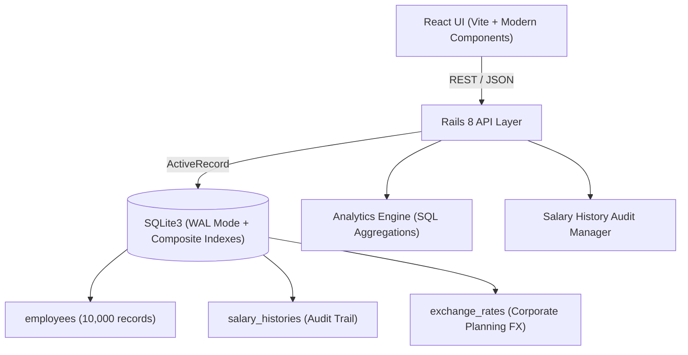

# System Architecture & Technical Design

## 1. System Overview

The ACME Salary Management System is engineered as a clean decoupled architecture:
- **Backend:** Ruby on Rails 8 API mode backed by a relational SQLite database (leveraging WAL mode, foreign keys, and targeted composite indexes).
- **Frontend:** React 18+ Single Page Application with a modern executive dashboard design system (Vanilla CSS + Lucide icons + Chart.js / visual metrics), responsive layout, and client-side caching.
- **Data Tier:** Relational schema optimized for read-heavy filtering, server-side pagination, atomic salary adjustment transactions, and immutable audit logging.

---

## 2. Relational Schema & Data Modeling

### 2.1 Table: `employees`
Stores current authoritative compensation and demographic state.
- `id` (INTEGER, Primary Key)
- `employee_code` (VARCHAR, UNIQUE, Indexed) - e.g. `ACM-00001`
- `first_name` (VARCHAR, Indexed)
- `last_name` (VARCHAR, Indexed)
- `email` (VARCHAR, UNIQUE, Indexed)
- `department` (VARCHAR, Indexed) - e.g. `Engineering`, `Sales`, `Marketing`, `Finance`, `HR`, `Operations`, `Product`, `Legal`
- `job_title` (VARCHAR)
- `country` (VARCHAR, Indexed) - `US`, `UK`, `IN`, `DE`, `CA`, `SG`, `AU`
- `currency` (VARCHAR(3), Indexed) - `USD`, `GBP`, `INR`, `EUR`, `CAD`, `SGD`, `AUD`
- `base_salary` (DECIMAL(14,2), NOT NULL) - stored in local currency
- `bonus` (DECIMAL(14,2), DEFAULT 0.0) - stored in local currency
- `effective_date` (DATE, NOT NULL)
- `status` (VARCHAR, Indexed, DEFAULT 'active') - `active`, `on_leave`, `terminated`
- `created_at`, `updated_at` (TIMESTAMP)

### 2.2 Table: `salary_histories`
Immutable audit log recording every change to base salary or bonus.
- `id` (INTEGER, Primary Key)
- `employee_id` (INTEGER, FOREIGN KEY REFERENCES `employees(id)`, Indexed)
- `previous_base_salary` (DECIMAL(14,2))
- `new_base_salary` (DECIMAL(14,2), NOT NULL)
- `previous_bonus` (DECIMAL(14,2))
- `new_bonus` (DECIMAL(14,2), NOT NULL)
- `currency` (VARCHAR(3), NOT NULL)
- `change_reason` (VARCHAR, NOT NULL) - `Annual Review`, `Promotion`, `Market Adjustment`, `Equity Correction`, `Starting Salary`
- `notes` (TEXT)
- `effective_date` (DATE, NOT NULL)
- `created_by` (VARCHAR, DEFAULT 'HR Admin')
- `created_at` (TIMESTAMP, Indexed)

### 2.3 Table: `exchange_rates`
Corporate planning foreign exchange rates benchmarked to USD for cross-country aggregation without corrupting nominal values.
- `id` (INTEGER, Primary Key)
- `from_currency` (VARCHAR(3), Indexed)
- `to_currency` (VARCHAR(3), DEFAULT 'USD')
- `rate` (DECIMAL(10,6), NOT NULL) - Multiplier to USD (e.g. 1 INR = 0.012 USD, 1 GBP = 1.28 USD)
- `fiscal_year` (INTEGER)

---

## 3. Indexing & 10,000 Record Performance Strategy

To guarantee sub-50ms latency across 10,000 records on SQLite:
1. **Search Composite Index:** Multi-column search for `(department, country, status)` to accelerate filtering combinations.
2. **Text Search Strategy:** Indexed prefix queries on `employee_code`, `email`, and combined name fields.
3. **Database Concurrency:** Rails 8 SQLite configuration with `journal_mode = WAL`, `synchronous = NORMAL`, and `cache_size = 1000000000` (1GB cache headroom).
4. **Zero Client-Side Bloat:** Enforced server-side pagination with limit/offset, returning lightweight response payloads (20 to 100 records per page).
5. **Database-Native Aggregations:** Summary KPIs computed directly via SQL `SUM`, `AVG`, `MIN`, `MAX`, and `GROUP BY` rather than instantiating 10,000 Ruby objects in memory.

---

## 4. API Endpoints Contract

### Employees
- `GET /api/v1/employees`
  - Query params: `page`, `per_page`, `search`, `department`, `country`, `currency`, `status`, `sort_by`, `sort_order`
  - Response: `{ employees: [...], pagination: { current_page, total_pages, total_count, per_page } }`
- `GET /api/v1/employees/:id`
  - Response: Full employee details + recent `salary_history` timeline
- `POST /api/v1/employees`
  - Creates employee and automatically seeds the initial `salary_histories` entry (`Starting Salary`)
- `PATCH /api/v1/employees/:id/salary`
  - Body: `{ new_base_salary, new_bonus, change_reason, effective_date, notes }`
  - Atomic transaction: Updates `employees` record and appends to `salary_histories`

### Analytics & Org Compensation Intelligence
- `GET /api/v1/analytics/overview`
  - Headcount, active employee count, total global payroll (USD), average & median salary, bonus pool
- `GET /api/v1/analytics/by_department`
  - Headcount, total spend (USD), avg salary per department
- `GET /api/v1/analytics/by_country`
  - Headcount, local nominal spend, converted USD spend, currency breakdown
- `GET /api/v1/analytics/salary_bands`
  - Distribution of employees across salary tiers
- `GET /api/v1/analytics/insights`
  - Dynamic answers to key executive questions ("Top compensation outliers", "Departmental cost drivers", "Cross-country parity index")

---

## 5. Security & Financial Precision Rules
1. **Monetary Safety:** Never use floating-point types (`FLOAT`/`DOUBLE`) for salary fields; strict `DECIMAL(14,2)` precision.
2. **Transactional Integrity:** Salary updates wrap `Employee#update!` and `SalaryHistory.create!` in `ActiveRecord::Base.transaction`. Any validation failure rolls back immediately.
3. **Audit Immutability:** Salary history records cannot be modified or deleted via API.
